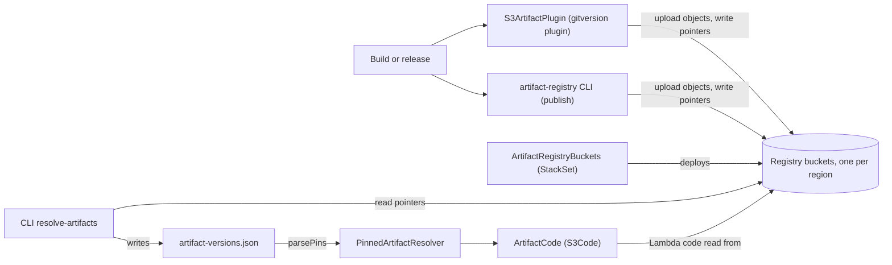

# artifact-registry

> **Built for [ServerlessInbox](https://github.com/serverlessinbox/serverlessinbox).** Issues and questions go to the [main repo](https://github.com/serverlessinbox/serverlessinbox/issues) · [Docs](https://docs.serverlessinbox.com)

Publishes build artifacts to versioned, per-region S3 buckets in a fixed layout, enabling deployments to reference them directly instead of uploading assets at deploy time. Artifacts are discoverable by version, channel, or release track.

## How it works



A build publishes artifacts into the per-region registry buckets, through the gitversion plugin or the CLI. Consumers resolve pinned versions with `resolve-artifacts`, whose output file feeds the resolver when each component key is the package name, and deploy straight from the buckets with the CDK resolver and `ArtifactCode`; the buckets themselves are deployed by `ArtifactRegistryBuckets`.

## Packages

| Package | What it is |
|---|---|
| [@serverlessinbox/artifact-registry](packages/artifact-registry) | The S3 layout, publishing and reading APIs, and CLI commands to build and publish artifacts. |
| [@serverlessinbox/artifact-registry-cdk](packages/artifact-registry-cdk) | CDK constructs that deploy the per-region S3 buckets of a registry and resolvers that locate artifacts in them. |
| [@serverlessinbox/artifact-registry-gitversion](packages/artifact-registry-gitversion) | A `@jwpkg/gitversion` plugin that publishes a workspace's artifacts on release. |

Usage and reference are in each package's README.

## Development

Node.js >= 20. Yarn 4 is bundled (`.yarn/releases`, `yarnPath` in `.yarnrc.yml`) with Plug'n'Play.

```bash
yarn install
yarn build
yarn test
yarn lint
```

## Releasing

A push to `main` runs the release workflow (`.github/workflows/release.yml`). It lints, versions the packages from conventional commits (`yarn gitversion bump`), builds them, packs them (`yarn gitversion pack`) and publishes them to npm (`yarn gitversion publish`).

## License

Apache-2.0, see [LICENSE](LICENSE).
