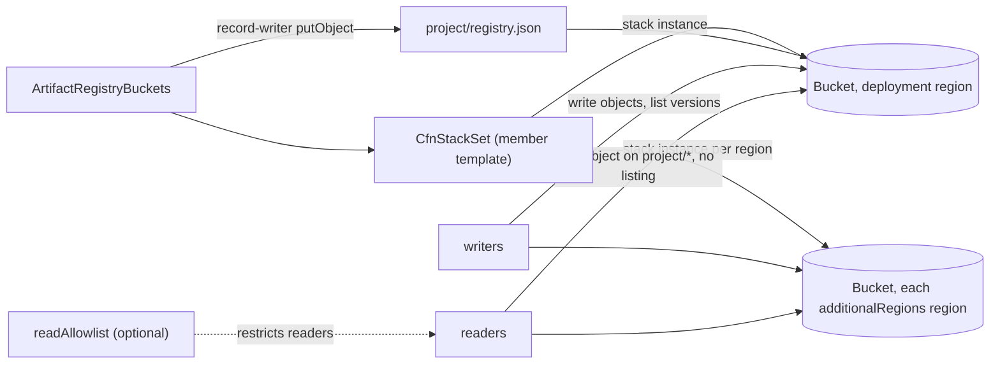
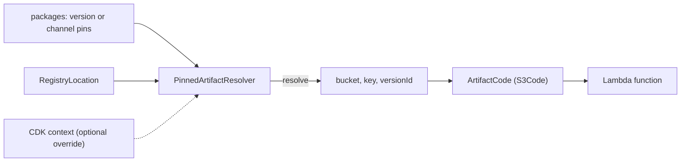

# @serverlessinbox/artifact-registry-cdk

CDK constructs for an artifact registry: one creates the S3 buckets of the registry, one per region, and writes a registry record into one of them that describes the registry; the others let a stack read artifacts from the registry, resolving a package to its bucket, key, URL and ARN and building Lambda `Code` from it.

An artifact registry is a set of identically configured buckets that a build publishes versioned artifacts to and that consumers read them from. The construct keeps the buckets and the description of where they are in one place.

Built for [ServerlessInbox](https://github.com/serverlessinbox/serverlessinbox).

## How it works

`ArtifactRegistryBuckets` deploys one bucket per region through a StackSet and writes the registry record; writers get write access and readers get read access on `{project}/*` without listing.



In a consuming stack, `PinnedArtifactResolver` locates an object and `ArtifactCode` turns it into Lambda code.



## What it deploys

- **A CloudFormation StackSet** that deploys one bucket in the account of the stack, in the region the stack is deployed in and in each region of `registry.additionalRegions`. Adding a region to the list adds a bucket; no per-region bootstrap is needed. Each bucket is versioned, blocks ACLs, enforces TLS, and expires replaced object versions after `channelHistoryRetention`.
- **The registry record**, a JSON object written to `{project}/registry.json` in the bucket of the region the stack is deployed in. It holds the schema version, `bucketBase`, `project`, `regions` (the deployment region followed by `registry.additionalRegions`, each once), the optional `bucketOverrides` and the account ID that owns the buckets. It is written when the stack is created and written again whenever the record changes.
- **A CloudFormation rule.** The deployment region gets a bucket automatically, so the stack needs no `env`; the rule rejects a deployment in a region that `registry.additionalRegions` also lists.

The construct creates no IAM roles and no stack outputs.

## Usage

```ts
import { ArtifactRegistryBuckets } from '@serverlessinbox/artifact-registry-cdk';

new ArtifactRegistryBuckets(stack, 'ArtifactRegistryBuckets', {
  registry: {
    bucketBase: 'acme-artifacts',
    project: 'acme',
    additionalRegions: ['us-east-1'],
  },
  writers: [{ principalArn: 'arn:aws:iam::111111111111:root' }],
  stackSetName: 'acme-artifact-buckets',
  stackSetAdministrationRole: administrationRole,
  stackSetExecutionRole: executionRole,
});
```

Deployed from `eu-west-1`, this creates buckets in `eu-west-1` and `us-east-1`. The region the stack is deployed in always gets a bucket and holds the registry record; `registry.additionalRegions` lists only the additional regions.

## Props

| Prop | Meaning |
|---|---|
| `registry.bucketBase` | Bucket names are `{bucketBase}-{region}`. |
| `registry.project` | Prefix of every object key; the record lives at `{project}/registry.json`. |
| `registry.additionalRegions` | The regions that get a bucket in addition to the region the stack is deployed in, which always gets one. The list may be empty and must not contain the deployment region; a region listed twice is counted once. |
| `registry.bucketOverrides` | Optional bucket names that replace the convention name, keyed by region. An override applies to every region that gets a bucket, including the deployment region. |
| `writers` | Principals (`principalArn`) allowed to write to every bucket. |
| `readAllowlist` | Optional. Restricts read access to the listed IAM principal ARNs. Readers fetch objects with `s3:GetObject` and `s3:GetObjectVersion` (CloudFormation reading templates, Lambda reading function code, and tools reading release pointers and the registry record). Without it, every authenticated AWS principal may read the objects under `registry.project`; with it, only the listed principals may read, and everyone else is denied. A reader asking for a nonexistent object is answered access-denied in both cases because readers cannot list the bucket. |
| `channelHistoryRetention` | Optional `Duration`, default 1 day. How long earlier versions of overwritten keys (channel objects and pointer files) stay retrievable, so a deployment that resolved an older channel object version can still roll back or redeploy within the window. Release objects are never overwritten and are not affected. A longer window adds S3 storage for those earlier versions. A whole number of days, otherwise synthesis fails, and at least 1, otherwise the StackSet parameter rejects it at deployment. |
| `stackSetName` | Name of the StackSet. |
| `stackSetAdministrationRole` | Role CloudFormation assumes to administer the StackSet. |
| `stackSetExecutionRole` | Role the administration role assumes to create the bucket stacks. |

## Bucket name overrides

A region listed in `registry.bucketOverrides` gets a bucket with that name instead of `{bucketBase}-{region}`. The override applies everywhere the bucket name matters: the bucket itself (the StackSet instance of that region receives it as its own parameter, the deployment region included), the registry record, and the target of the record write. Regions without an override keep the convention name.

Changing the override of a region that already has a bucket makes CloudFormation create a bucket under the new name while the old, retained bucket stays behind. Review such a change before deploying it.

## Read access

Every authenticated AWS principal may read the objects under `{project}/*` by default. Readers cannot list the bucket; a request for a nonexistent object is answered access-denied. The registry record itself is also readable to authenticated principals without an allowlist.

Pass `readAllowlist` to restrict read access to specific principals:

```ts
new ArtifactRegistryBuckets(stack, 'ArtifactRegistryBuckets', {
  // ...
  readAllowlist: {
    principalArns: [
      'arn:aws:iam::111111111111:root',  // every principal of the account
      'arn:aws:iam::222222222222:role/deployer',  // one role in another account
    ],
  },
});
```

Pass well-formed ARNs: S3 rejects a bucket policy whose principal it cannot resolve. List every AWS account and role that runs `resolve-artifacts`, reads the registry record, or deploys from the registry (CloudFormation stacks and Lambdas).

## Requirements

- The stack needs no `env`. The region it is deployed in gets a bucket automatically and holds the record, so it must not be in `registry.additionalRegions`: a CloudFormation rule fails the deployment with a message naming that list otherwise. Deploy the stack in the region that should hold the record.
- The stack is bootstrapped: the member template is published as a CDK asset, and the record is written by an `AwsCustomResource`.
- The StackSet administration and execution roles are passed in. The execution role needs permission to manage CloudFormation stacks and to create and configure S3 buckets and bucket policies.

## Adopting existing buckets

The StackSet resource takes the logical ID of the construct id you choose. Using the id `PublicationAssetsBucketStackSet` gives the StackSet that logical ID, so a stack that already deploys a StackSet under that id keeps that StackSet instead of replacing it. The member template keeps the logical IDs of the bucket and the bucket policy.

## Resolving artifacts

A stack that deploys artifacts from the registry (Lambda zips, nested templates) asks an `IArtifactResolver` where an object is. Constructs take the interface, so the registry, the pinned versions and the region logic are decided once, where the resolver is built.

```ts
import { ArtifactCode, ArtifactZone, PinnedArtifactResolver } from '@serverlessinbox/artifact-registry-cdk';

const resolver = new PinnedArtifactResolver({
  location: { bucketBase: 'acme-artifacts', project: 'acme' },
  deploymentRegion: stack.region,
  packages: {
    'acme-api': { zone: ArtifactZone.REGIONAL, version: '1.4.2' },
    'acme-edge': { zone: ArtifactZone.EDGE, channel: 'dev' },
  },
});

new lambda.Function(stack, 'Api', {
  runtime: lambda.Runtime.PROVIDED_AL2023,
  handler: 'bootstrap',
  code: new ArtifactCode(stack, resolver, 'acme-api', 'lambdas/api.zip'),
});

resolver.getUrl('acme-api', 'templates/app.yaml');
resolver.getArn('acme-api', 'lambdas/api.zip');
resolver.getVersion('acme-api'); // '1.4.2'; the channel name for a channel pin
```

| Member | Meaning |
|---|---|
| `resolve(package, path)` | The `bucket`, `key` and, when pinned, `versionId` of the object. |
| `getUrl(package, path)` | The HTTPS URL of the object, with `?versionId=` when pinned. |
| `getArn(package, path)` | The `arn:aws:s3:::bucket/key` of the object. |
| `getVersion(package)` | The pinned release version, or the channel name. |
| `location` | The `RegistryLocation` (`bucketBase`, `project`, `bucketOverrides`) every object lives under. |

Every method that takes a package throws `No resolved data for package '<name>'` for a package without a pin.

### Pins

A pin names the package's `zone` and exactly one of `version` (a release) or `channel` (a mutable channel, whose objects each publish overwrites). A pin with neither or both is rejected, naming the package.

- A `REGIONAL` pin is read from the bucket of the deployment region; an `EDGE` pin from the bucket of `us-east-1`, whatever the deployment region.
- A pin's optional `region` wins over its zone.
- `objectVersionIds` pins listed object keys to an S3 object version: the object then resolves with its `versionId`, `getUrl` appends `?versionId=`, and the Lambda keeps running the pinned bytes when the key is overwritten.
- `ArtifactCode` is an `S3Code`; it imports each registry bucket once per stack. Importing creates no resources and no stack exports.

### Shipping pins with your package

`PinnedArtifactResolver.parsePins(json, source)` validates pins from JSON text, for example a file shipped in your package, and throws naming `source`, the package and the field on any problem:

```json
{
  "acme-api": { "zone": "regional", "version": "1.4.2" },
  "acme-edge": { "zone": "edge", "channel": "dev" }
}
```

`PinnedArtifactResolver.fromContext(scope, props)` builds the resolver from such default pins and a default location, overridden by CDK context during development. The two context keys are yours to name (`artifactsContextKey`, `objectVersionsContextKey`):

- the `artifactsContextKey` value is an object with the optional fields `bucketBase`, `project`, `bucketOverrides` and `packages`; each location field present replaces the default's field, and each pin in `packages` replaces the default pin of that package or adds one;
- the `objectVersionsContextKey` value maps object keys to S3 object version IDs.

With no context set the resolver holds exactly the defaults. A present value of the wrong shape, or a context pin without a `zone`, throws naming the key and the value.

## License

Apache-2.0
