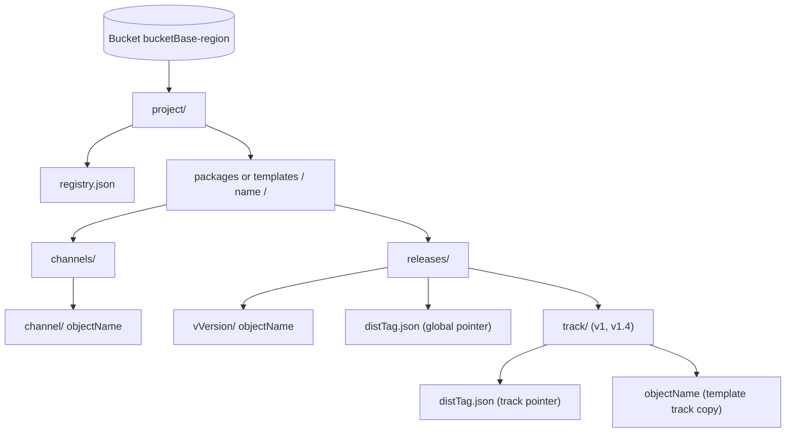
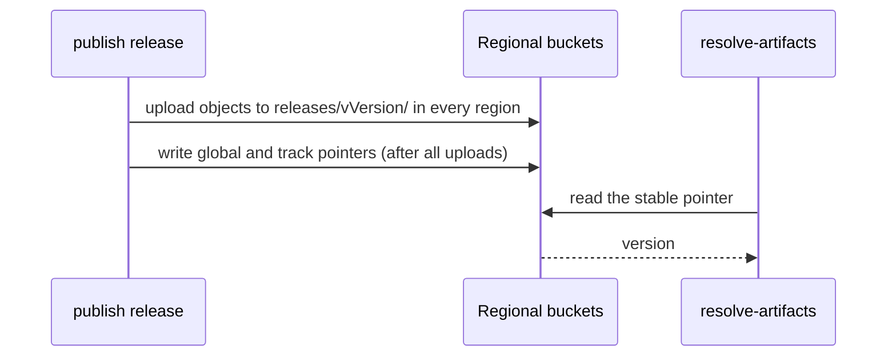

# @serverlessinbox/artifact-registry

Publishes build artifacts to versioned, per-region S3 buckets in a fixed layout, and finds them again by version, channel or track.

Built for [ServerlessInbox](https://github.com/serverlessinbox/serverlessinbox).

## Why this package exists

Infrastructure-as-code deployments usually upload their own assets (function code, static files, nested templates) at deploy time, into a staging location that must first exist in the target account. That ties a deployment to a prepared account and a build machine. `artifact-registry` separates publishing from deploying: assets are published ahead of time to versioned S3 locations per region, in a fixed layout, and templates reference those locations directly. A deployment then needs no staging, so it works in any AWS account.

The package defines that layout and provides both sides:

- **Publishing**: a CLI and a programmatic API put each artifact in the right place, as an immutable release or on a mutable channel, and write pointers to the current version of a release line.
- **Reading**: loaders, a resolver and key builders find where an artifact for a given version, channel or track lives, so no consumer hand-writes an S3 key.

Publishing as part of a [`@jwpkg/gitversion`](https://github.com/jwpkg/gitversion) release is done by the separate `@serverlessinbox/artifact-registry-gitversion` package.

## How it works

Every object lives under the project prefix of a regional bucket, either in an immutable release or on a mutable channel. Release pointers and the registry record sit beside them.



A release uploads its objects to every region first and writes pointers only when all uploads succeeded; a consumer reads the pointer to learn which version to use.



## Concepts

| Concept | Meaning |
|---|---|
| Artifact type | `package` (keys under `packages/`) or `template` (keys under `templates/`). With a name it identifies one published unit, for example `package` + `example-api`. |
| Release | An immutable, versioned set of objects at `releases/v{version}/`. The version never carries a `v`; the path adds it. |
| Channel | A mutable path, `channels/{channel}/` (for example `dev`). Each publish overwrites the same keys. |
| Track | A version line: `v{major}` (for example `v1`) or `v{major}.{minor}` (for example `v1.4`). Track names always carry a `v`. |
| Pointer | `{distTag}.json`, written once globally and once per track of a release. Its body is `{ version, publishedAt, objects: [{ name }] }`. `distTag` is `stable` for a normal release, or the first prerelease identifier (`beta` for `1.2.0-beta.0`) for a prerelease. |
| Track copy | For `template` artifacts, a release also uploads each object to `releases/latest/{objectName}`, or `releases/{prereleaseLabel}/{objectName}` for a prerelease. |
| Regional bucket | One bucket per region, named `{bucketBase}-{region}` unless overridden, for example `example-artifacts-eu-west-1`. |
| Zone | `regional` or `edge`. At publish time `edge` means `us-east-1`; `regional` means the registry's `regions`. When reading, `regional` resolves in the deployment region. |

## Installation

```bash
yarn add --dev @serverlessinbox/artifact-registry
```

## Publishing

### Workspace config

A workspace that publishes artifacts has an `artifact-registry.json` at its root; the fields are in [Reference](#artifact-registryjson).

```json
{
  "registry": {
    "bucketBase": "example-artifacts",
    "project": "example",
    "regions": ["eu-west-1", "eu-central-1"],
    "bucketOverrides": { "us-east-1": "example-artifacts-use1-7f3a" }
  },
  "type": "package",
  "name": "example-api",
  "artifacts": [
    { "source": "dist/handler", "objectName": "lambdas/handler.zip" },
    { "source": "src/hook.ts", "objectName": "lambdas/hook.zip", "bundleType": "js-zip" },
    { "source": "dist/edge.zip", "objectName": "lambdas/edge.zip", "zone": "edge" },
    { "source": "dist/eu-only.zip", "objectName": "lambdas/eu-only.zip", "regions": ["eu-west-1"] }
  ]
}
```

The regions an artifact is published to are its own `regions`, else `us-east-1` when its `zone` is `edge`, else the registry's `regions`.

### CLI

The package installs the `artifact-registry` binary.

| Command | What it does | Options |
|---|---|---|
| `build` | Builds the artifacts into an output folder without uploading, and prints the written file names. | `--output` output folder, must exist (required); `--cwd` workspace directory (default: current directory) |
| `publish channel` | Builds the artifacts and uploads each to `channels/{channel}/{objectName}` in every target region. Writes no pointers. | `--channel` (default `dev`); `--cwd`; `--profile`; `--object`; `--region` |
| `publish release` | Builds the artifacts, uploads each to `releases/v{version}/{objectName}` in every target region, then writes the pointers of each package and, for `template` packages, the track copies. | `--version` semver (required); `--cwd`; `--profile`; `--object`; `--region` |
| `resolve-artifacts` | Reads the `stable` pointer of each component and writes a JSON object of component key to `{ "version", "zone" }` to every `--output`. Components of zone `edge` are read from the edge zone's fixed region (`us-east-1`) whatever `--region` says. Reads only. | `--bucket-base` (required); `--project` (required); `--region` the region whose bucket is read for `regional` components (required); `--component` as `key:type:name:zone`, zone `regional` or `edge` (required, repeatable); `--output` (required, repeatable); `--track` (without it the global pointer is read); `--bucket-override` as `region=bucket` (repeatable); `--profile` |
| `registry-record fetch` | Fetches the registry record from a published location and writes it as formatted JSON. | `--bucket-base` (required); `--project` (required); `--region` (required); `--output` (required); `--bucket-override` as `region=bucket` (repeatable) |
| `registry-record check` | Checks if a local registry record file matches the live record in S3. It reads the live record from the bucket of the region given by `--region`. Exits `0` when the records are equal and `1` on any difference. | `record-file` path (positional, required); `--region` the region whose bucket holds the live record (required) |

Building is the same in `build`, `publish channel` and `publish release`: a directory is zipped (file paths and modes kept), a file is copied, and an entry with `bundleType: "js-zip"` is bundled with esbuild into a zip holding `index.js`. A built file is named after the basename of its `objectName`, so basenames must be unique within a workspace.

On the publish commands:

- `--object` publishes only the artifact with that `objectName`; the command fails when none matches.
- `--region` (repeatable) restricts publishing to a subset of the targets. The command fails when a given region is a target of none of the selected artifacts.
- `--profile` sets `AWS_PROFILE` for the run.

```bash
yarn artifact-registry build --output dist/artifacts
yarn artifact-registry publish channel --channel dev --object lambdas/handler.zip
yarn artifact-registry publish release --version 1.2.3 --region eu-west-1
yarn artifact-registry resolve-artifacts \
  --bucket-base example-artifacts --project example --region eu-west-1 --track v1 \
  --component api:package:example-api:regional --component cdn:package:example-edge:edge \
  --output artifact-versions.json
```

### Publish order and failure handling

`publish release` first uploads every object of every package to all of that package's regions. Only when all of those uploads succeeded are the pointers and track copies written. A pointer found in a region therefore names objects that exist there. A failure in one region never stops the others; afterwards a `RegionPublishError` names each failed bucket and no pointers are written. Running the same publish again completes the failed regions.

### From code

`buildArtifacts(workspaceCwd, outputFolder, configOverride?)` does what `build` does and returns `{ outputFiles, routingMap }`: the basenames written to `outputFolder`, and for each basename its package, `objectName` and targets. The config comes from `configOverride`, else from `artifact-registry.json` in `workspaceCwd`; a workspace without that file yields no outputs. `outputFolder` must already exist.

`RegionalPublisher` publishes through one `S3Uploader` per region:

```ts
import { SemVer } from 'semver';
import { S3Client } from '@aws-sdk/client-s3';
import { RegionalPublisher, RegionPublishError, S3Uploader, buildArtifacts, toArtifactPackageMapKey } from '@serverlessinbox/artifact-registry';
import type { ReleaseTrackCopy } from '@serverlessinbox/artifact-registry';

const built = await buildArtifacts('packages/example-api', 'dist/artifacts');

const uploaders = new Map<string, S3Uploader>();
const packages = new Map<string, ReleaseTrackCopy>();
for (const [basename, routing] of built.routingMap) {
  for (const target of routing.targets) {
    if (!uploaders.has(target.region)) {
      uploaders.set(target.region, new S3Uploader(new S3Client({ region: target.region })));
    }
  }
  const key = toArtifactPackageMapKey(routing.package);
  const copy = packages.get(key) ?? { package: routing.package, targets: routing.targets, entries: [] };
  copy.entries.push({ objectName: routing.objectName, filePath: `dist/artifacts/${basename}` });
  packages.set(key, copy);
}

try {
  await new RegionalPublisher(uploaders).uploadRelease({
    version: new SemVer('1.2.3'),
    packages: [...packages.values()],
  });
} catch (err) {
  if (err instanceof RegionPublishError) {
    console.error(err.failed.map((f) => `${f.target.bucketName}: ${f.cause.message}`));
  }
  throw err;
}
```

`RegionalPublisher` methods:

- `uploadRelease(upload)`: uploads all objects of all packages, then, if every upload succeeded, writes each package's pointers and the track copies of template packages.
- `uploadChannel(routing, channel, filePath)`: uploads one file to the channel path of every target.
- `uploadObject(targets, key, filePath)`: uploads one file to the same key in every target.
- `writeVersionPointers(release, version)`: writes the global, `v{major}` and `v{major}.{minor}` pointers of one package to its targets. `release.objects` lists the object names the pointer names.

`RegionPublishError` carries `succeeded: RegionBucket[]` and `failed: RegionFailure[]` (`{ target, cause }`).

## Reading

Packages may live in buckets of other regions than the client's, so construct the `S3Client` with `followRegionRedirects: true`.

```ts
import { S3Client } from '@aws-sdk/client-s3';
import {
  ArtifactResolver,
  buildArtifactArn,
  buildArtifactBucketName,
  buildArtifactKey,
  buildArtifactUrl,
  buildReleasePointerKey,
  deriveTrack,
  loadChannelVersions,
  loadTrackVersions,
  readReleasePointer,
} from '@serverlessinbox/artifact-registry';
import type { RegistryLocation } from '@serverlessinbox/artifact-registry';

const client = new S3Client({ region: 'eu-west-1', followRegionRedirects: true });
const location: RegistryLocation = { bucketBase: 'example-artifacts', project: 'example' };
```

### Registry record

The registry record (`{project}/registry.json`, written to every region bucket) holds the configuration of where artifacts are published: the bucket base, project, list of regions, any bucket overrides, the schema version (currently `1`), and the AWS account ID that owns the buckets. It is fetched and validated to verify the record is complete and readable.

The shape of the registry, which is the record, its location and the bucket naming, is also importable on its own from the `@serverlessinbox/artifact-registry/registry` subpath. It has no S3 client, build or semver dependencies, so construct libraries and other consumers that only need the registry shape import it without pulling in the publishing code.

```ts
import { buildArtifactBucketName, parseRegistryRecord, registryRecordKey } from '@serverlessinbox/artifact-registry/registry';
import type { RegionBucket, RegistryConfig, RegistryLocation, RegistryRecord } from '@serverlessinbox/artifact-registry/registry';
```

`loadRegistryRecord(client, location, region)` reads and validates the record from the bucket of `region`. It throws when the record is missing or not readable (both NoSuchKey and AccessDenied are reported as "missing or not readable"). `parseRegistryRecord(text, source)` parses and validates a record from JSON text, naming the source (path, URL, or bucket/key) in errors.

```ts
const record = await loadRegistryRecord(client, location, 'eu-west-1');
console.log(record.bucketBase, record.project, record.regions, record.ownerAccountId);
```

`registryRecordKey(project)` builds the S3 key for the record: `{project}/registry.json`.

### Loaders

`loadChannelVersions(client, options)` lists the objects under the channel of each package and returns a flat map of S3 key to the S3 version ID of its latest version. `packages` maps package name to region.

```ts
const channelVersionIds: Record<string, string> = await loadChannelVersions(client, {
  location,
  artifactType: 'package',
  channel: 'dev',
  packages: { 'example-api': 'eu-west-1', 'example-edge': 'us-east-1' },
});
```

`loadTrackVersions(client, options)` reads the `stable` pointer of each package (track-scoped, or the global one when `track` is omitted), then lists the objects of the version it names. It returns `versionMap` (S3 key to version ID) and `resolvedVersions` (package name to version), and throws when a pointer is missing, malformed or names an invalid semver.

```ts
const { versionMap, resolvedVersions } = await loadTrackVersions(client, {
  location,
  track: 'v1',
  artifactType: 'package',
  packages: { 'example-api': 'eu-west-1' },
});
```

`readReleasePointer(client, location, packageName, distTag, region, track?)` reads and validates the pointer of a `package`; without `track` it reads the global pointer. It throws when the pointer is missing or not readable (NoSuchKey and AccessDenied are both reported as "missing or not readable"), empty, not valid JSON or malformed.

```ts
const pointer = await readReleasePointer(client, location, 'example-api', 'stable', 'eu-west-1', 'v1');
console.log(pointer.version, pointer.publishedAt, pointer.objects.map((o) => o.name));
```

### Resolver

`ArtifactResolver` is a synchronous, per-package lookup of where an object lives. It reads nothing from S3. Each package entry has a pinned `version` and a `zone`: `regional` resolves in `deploymentRegion`, `edge` in `us-east-1`. An entry may also set `region`, which wins over `zone`, and `channel`, which resolves under the channel path instead of the release path of its version. `artifactType` defaults to `package`.

```ts
const resolver = new ArtifactResolver({
  versions: {
    packages: {
      'example-api': { version: '1.4.2', zone: 'regional' },
      'example-edge': { version: '1.4.2', zone: 'edge' },
      'example-dev': { version: '1.4.2', zone: 'regional', channel: 'dev' },
    },
  },
  location,
  deploymentRegion: 'eu-west-1',
  s3VersionMap: channelVersionIds,
});
const { bucket, key, versionId } = resolver.resolve('example-api', 'lambdas/handler.zip');
const url = resolver.getUrl('example-api', 'lambdas/handler.zip');
const arn = resolver.getArn('example-api', 'lambdas/handler.zip');
```

`resolve` returns `{ bucket, key, versionId? }`; `versionId` is set when the key is listed in `s3VersionMap`. `getUrl`, `getArn`, `resolve` and `getVersion` throw for a package the resolver does not know. CDK stacks resolve through `PinnedArtifactResolver` and the `IArtifactResolver` interface in `@serverlessinbox/artifact-registry-cdk`.

### Keys, URLs and ARNs

```ts
const releaseKey: string = buildArtifactKey('package', 'example-api', {
  type: 'release',
  version: { version: '1.4.2' },
  objectName: 'lambdas/handler.zip',
  project: 'example',
});
const pointerKey: string = buildReleasePointerKey('package', 'example-api', { project: 'example', track: 'v1', distTag: 'beta' });
const bucketName: string = buildArtifactBucketName(location, 'eu-west-1');
const url: string = buildArtifactUrl(bucketName, 'eu-west-1', releaseKey, 'abc123');
const arn: string = buildArtifactArn(bucketName, releaseKey);
const track: string = deriveTrack('1.4.2', 'minor');
```

- `buildArtifactKey(artifactType, name, spec)`: the S3 key for the layout `spec.type` selects (see the key table below).
- `buildReleasePointerKey(artifactType, name, { project, track?, distTag? })`: the pointer key. `distTag` defaults to `stable`; without `track` it is the global pointer.
- `buildArtifactBucketName(location, region)`: `location.bucketOverrides?.[region]`, else `{bucketBase}-{region}`.
- `buildArtifactUrl(bucket, region, key, versionId?)`: `https://{bucket}.s3.{region}.amazonaws.com/{key}`, with `?versionId=` appended when given.
- `buildArtifactArn(bucket, key)`: `arn:aws:s3:::{bucket}/{key}`.
- `deriveTrack(version, granularity)`: `'major'` gives `v1`, `'minor'` gives `v1.4`. It throws on anything that is not `major.minor.patch` with an optional prerelease or build suffix, including a `v`-prefixed version.

## Reference

### `artifact-registry.json`

`loadWorkspaceConfig(cwd, fileName?)` loads and validates it.

| Field | Type | Required | Description |
|---|---|---|---|
| `registry.bucketBase` | string | yes | Base name of the buckets: `{bucketBase}-{region}`. |
| `registry.project` | string | yes | Leading segment of every object key. |
| `registry.regions` | string[] | yes | Regions an artifact is published to when it sets neither `regions` nor `zone: "edge"`. Non-empty, no duplicates. |
| `registry.bucketOverrides` | object | no | Region to bucket name, replacing `{bucketBase}-{region}` for that region. Each name must be 3 to 63 lowercase letters, digits, dots or hyphens, starting and ending with a letter or digit. Every overridden region must be a target of at least one artifact. |
| `type` | `"package"` or `"template"` | yes | Artifact type; selects the `packages` or `templates` key prefix. |
| `name` | string | yes | Package name in the key. |
| `artifacts` | array | yes | The artifacts to build and publish. |
| `artifacts[].source` | string | yes | Path to a file or directory, absolute or relative to the workspace directory. |
| `artifacts[].objectName` | string | yes | Object name in S3, for example `lambdas/handler.zip`. |
| `artifacts[].name` | string | no | Package name for this artifact instead of `name`. |
| `artifacts[].zone` | `"regional"` or `"edge"` | no | `edge` publishes to `us-east-1` only; `regional` is the registry's `regions`. |
| `artifacts[].regions` | string[] | no | Explicit regions for this artifact; wins over `zone`. Non-empty, no duplicates. |
| `artifacts[].bundleType` | `"js-zip"` | no | Bundles a TypeScript or JavaScript entry point with esbuild (Node 18, CommonJS, `aws-sdk` external) into a zip holding `index.js`. |

All artifacts of one package name must be published to the same set of regions; the config is rejected otherwise, because a region's pointer would name objects absent from it.

### S3 key layout

`{prefix}` is `packages` for `package` and `templates` for `template`.

| Kind | Key |
|---|---|
| Release object | `{project}/{prefix}/{name}/releases/v{version}/{objectName}` |
| Channel object | `{project}/{prefix}/{name}/channels/{channel}/{objectName}` |
| Pointer, global | `{project}/{prefix}/{name}/releases/{distTag}.json` |
| Pointer, track | `{project}/{prefix}/{name}/releases/{track}/{distTag}.json` |
| Track copy | `{project}/{prefix}/{name}/releases/{track}/{objectName}` |

Release `1.2.3` of package `example-api` with object `lambdas/handler.zip` in project `example` produces:

```
example/packages/example-api/releases/v1.2.3/lambdas/handler.zip
example/packages/example-api/releases/stable.json
example/packages/example-api/releases/v1/stable.json
example/packages/example-api/releases/v1.2/stable.json
```

### Exports

- Publishing: `buildArtifacts`, `loadWorkspaceConfig`, `RegionalPublisher`, `RegionPublishError`, `S3Uploader`; types `S3WorkspaceConfig`, `S3ArtifactEntry`, `ArtifactBuildResult`, `ArtifactRouting`, `ArtifactPackage`, `ArtifactType`, `RegionFailure`, `ReleaseUpload`, `PackageRelease`, `ReleaseTrackCopy`, `ReleaseTrackEntry`.
- Keys and locations: `buildArtifactKey`, `buildReleasePointerKey`, `buildArtifactBucketName`, `buildArtifactUrl`, `buildArtifactArn`, `deriveTrack`, `toArtifactPackageMapKey`, `isArtifactRouting`; types `ArtifactKeySpec`, `ReleasePointerKeyOptions`, `RegistryLocation`, `RegistryConfig`, `RegionBucket`.
- Registry record: `registryRecordKey`, `parseRegistryRecord`, `loadRegistryRecord`; type `RegistryRecord`.
- Subpath `@serverlessinbox/artifact-registry/registry`: `buildArtifactBucketName`, `registryRecordKey`, `parseRegistryRecord`; types `RegistryLocation`, `RegistryConfig`, `RegionBucket`, `RegistryRecord`. The root export includes all of these too.
- Reading: `loadChannelVersions`, `loadTrackVersions`, `readReleasePointer`, `ArtifactResolver`; types `ChannelVersionsOptions`, `TrackVersionsOptions`, `TrackVersionsResult`, `ArtifactResolverFactoryOptions`, `ResolvedArtifact`, `ArtifactZone`, `ArtifactVersionsEntry`, `ParsedArtifactVersions`, `ReleasePointer`, `ReleasePointerObject`.
- Subpath `@serverlessinbox/artifact-registry/resolution`: `ArtifactResolver`, `buildArtifactUrl`, `buildArtifactArn`; types `ResolvedArtifact`, `ArtifactResolverFactoryOptions`, `ArtifactZone`, `ArtifactVersionsEntry`, `ParsedArtifactVersions`. This subpath has no S3 client or build dependencies, so consumers using only the resolver import it without pulling in publishing code.

## Requirements

AWS credentials through the default AWS SDK credential chain: environment variables, a shared or SSO profile (`AWS_PROFILE`, or `--profile` on the CLI), or a role. Publishing needs write access to the target buckets. Reading pointers needs read access; `loadChannelVersions` and `loadTrackVersions` also need permission to list object versions.

## License

Apache-2.0
